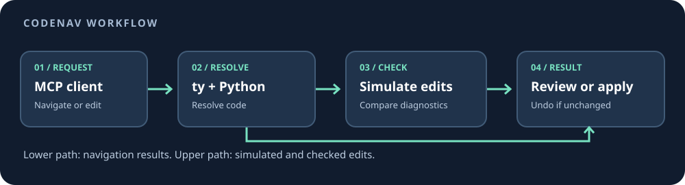

[](https://pypi.org/project/codenav-mcp/)

# codenav-mcp

Give AI agents Python code navigation and refactoring through the Model Context Protocol. codenav-mcp uses [ty](https://github.com/astral-sh/ty)'s language server to resolve definitions, references and call sites, and checks proposed edits for type diagnostics before writing them.



An MCP client sends a request to codenav-mcp. Navigation uses ty to resolve code; edits are simulated and checked before they are previewed or applied. Applied edits can be undone while the server retains its edit journal, if the files have not changed since.

## Quick start

Install [uv](https://docs.astral.sh/uv/), then register the server with your MCP host from the project root. The host starts it when needed.

**Claude Code:**

```bash
claude mcp add codenav -- uvx codenav-mcp
```

**Codex** (user configuration):

```bash
codex mcp add codenav -- uvx codenav-mcp
```

**OpenCode** (project configuration):

```bash
opencode mcp add codenav -- uvx codenav-mcp
```

See [configuration](docs/configuration.md) for Claude Code and Cursor configuration, workspace selection and environment variables.

## Requirements and limits

- Python 3.11 or later; the package installs ty and its other dependencies.
- Navigation and edits target Python (`.py` and `.pyi`). Positions are 1-indexed; columns use UTF-16 offsets.
- Edit tools normally check type diagnostics and allow no new errors by default. Use `apply=false` to preview; `apply_edit` can explicitly apply a preview despite its diagnostic limit. Read-only mode disables writes. Checks are not a substitute for tests.
- Batch calls run in order and are not atomic. Tool results are capped at 30,000 characters by default (`CODENAV_MCP_MAX_OUTPUT_CHARS`). See the [tool reference](docs/tools.md) for safety rules, output limits and [known limits](docs/tools.md#known-limits).

## Environment

See [configuration](docs/configuration.md#environment) for environment variables.

## Tests

From a checkout, run `uv sync --group dev` and `uv run pytest`. See [development](docs/development.md) for lint and package smoke-test commands. No evaluation score is reported here.

## Documentation

- [Tool reference](docs/tools.md): navigation, edits, safety and batching.
- [Configuration](docs/configuration.md): host setup, workspace and ty selection.
- [Development](docs/development.md): local setup and tests.
- [Documentation index](docs/INDEX.md).

Related: [webnav-mcp](https://pypi.org/project/webnav-mcp/) provides navigation for JS/TS/HTML/CSS. [Design notes](https://github.com/illescasDaniel/SpaceMaker/blob/main/docs/agent-tooling.md) cover Protocol conformance, positioning and output formats.

## License

[MIT](LICENSE).
